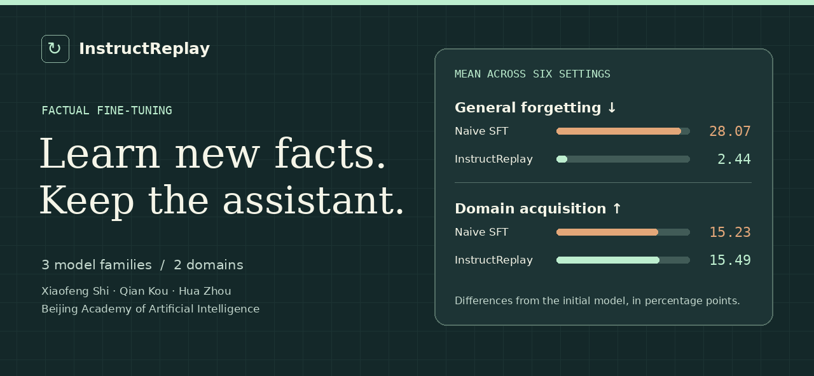

<p align="center">
  
</p>

# InstructReplay

**Teach an instruction-tuned model new facts while preserving how it answers.**

InstructReplay reuses the initial model’s own assistant turns as a training signal. The initial model answers a set of general instructions once. During factual fine-tuning, a frozen copy of that model supplies next-token targets on the saved replies. This lets the adapted model practice its original assistant behavior alongside learning new facts.

Xiaofeng Shi, Qian Kou, and Hua Zhou · Beijing Academy of Artificial Intelligence (BAAI)

[**Project homepage**](https://xiaofengshi.github.io/InstructReplay/) · [**Results and protocol**](docs/results.md) · [**Training guide**](docs/training.md) · [**Evaluation guide**](docs/evaluation.md) · [**Cite**](#citation)

[](https://github.com/xiaofengShi/InstructReplay/actions/workflows/tests.yml)
[](LICENSE)

## What we found

Across three model families and two domains, InstructReplay lowered average forgetting on five General benchmarks from **28.07 to 2.44 percentage points**, with mean domain acquisition of **+15.49 pp** versus **+15.23 pp** for standard fine-tuning. In all six settings it had the highest acquisition-minus-forgetting score among seven tested adaptation baselines.

| Six-setting mean | Standard fine-tuning | InstructReplay |
| --- | ---: | ---: |
| Domain acquisition, higher is better | +15.23 pp | **+15.49 pp** |
| General forgetting, lower is better | 28.07 pp | **2.44 pp** |
| Median IFEval response length relative to the initial model | 0.11× | **0.85×** |

**What gets replayed matters.** The mean IFEval drop was 43.3 pp when KL was applied to domain answers, 14.2 pp on samples from a beginning-of-sequence token, and 2.6 pp on the initial model’s own assistant turns in the native chat template. With the loss and instruction prompts held fixed, replaying self-generated answers gave 3.1 pp forgetting versus 7.5 pp for the tested dataset answers.

The six settings combine SmolLM3-3B, Qwen3-4B, and Phi-4-mini-instruct with CommonCorpus energy/engineering and PMC biomedical QA. The reported acquisition uses model-judge confirmation on 512 closed-book questions per domain. The findings come from short, 300-step adaptation runs on these models and benchmarks. [See all six settings, the matched controls, and limitations.](docs/results.md)

## How it works

1. **Generate once.** Give the initial model 9,600 general instructions in its native chat template. Save each sampled reply as tokens, preserving where the assistant response starts and ends.
2. **Train on paired examples.** Combine response-only cross-entropy on a domain answer with forward KL from the frozen initial model on the saved general reply. The two terms normalize each response by its own length.
3. **Measure acquisition and forgetting.** Score the adapted and initial checkpoints under the same protocol. Report domain acquisition alongside drops on IFEval, MMLU, MATH-500, BBH, and HumanEval+.

The paper used one replay sequence per domain sequence and a replay weight of 0.25. See the [training configuration and execution instructions](docs/training.md).

## Quick start

Check the public implementation on CPU with Python 3.10.

```bash
git clone https://github.com/xiaofengShi/InstructReplay.git
cd InstructReplay
python3.10 -m venv .venv
source .venv/bin/activate
python -m pip install torch==2.6.0 --index-url https://download.pytorch.org/whl/cpu
python -m pip install -e '.[dev]'
CUDA_VISIBLE_DEVICES='' python -m pytest -q
```

| I want to… | Start here |
| --- | --- |
| Prepare my own replay buffer and fine-tune | [Training guide](docs/training.md) · `instructreplay-generate` and `instructreplay-train` |
| Recompute A, F, W, and S from scored outputs | [Evaluation guide](docs/evaluation.md) · `instructreplay-metrics` |
| Inspect or plot the reported results | [Results notes](docs/results.md) · [CSV](docs/results.csv) |
| Inspect the objective | [Loss implementation](src/instructreplay/losses.py) · [Training step](src/instructreplay/trainer.py) |

For GPU training, install the appropriate CUDA build of PyTorch 2.6 and the `train` extra in a separate environment. The training guide covers runtime versions, local model and data inputs, and the run-identity checks. You supply compatible model weights, licensed training data, and the benchmark scorers. The code includes the replay generator, trainer, metric aggregation, configuration, and tests.

## Citation

If you use the code or reported results, cite Xiaofeng Shi, Qian Kou, and Hua Zhou, *InstructReplay: Replaying Assistant Turns to Preserve General Behavior During Factual Fine-Tuning* (2026). [Citation metadata](CITATION.cff)

The software is available under the [Apache License 2.0](LICENSE). [Attribution notices](NOTICE)
